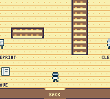
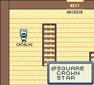
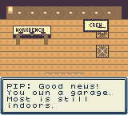
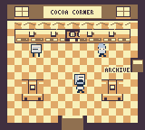
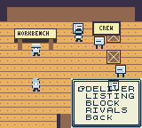
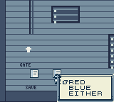

# Hollywild: Elf-Made Empire

An open-world holiday city adventure about overlooked properties, mischievous expeditions, and an elf-powered business empire.

**Status: native Game Boy Color campaign with neighborhood stories, original music, and upgraded art. Human completion time and physical Chromatic playback remain untested.**

Built for ModRetro Chromatic using GB Studio 4.3.2. The development computer runs the editor, compiler, and tests. The playable deliverable is a native `.gbc` cartridge.

## Playable foundation

- Five freely connected districts, a garage, four property interiors, and ten new campaign locations.
- Original pixel art, animated characters, dialogue, and property listings.
- Seven original four-channel music tracks, saved Play/Mute setting, and visible room improvements.
- Salvage jobs, optional bonus salvage, deliveries, five local commissions, and cancellation.
- Three crew roles, workshop production, and purchasable properties with visible ownership signs.
- A 24-mission campaign with 144 objectives, 45 puzzles, and three endings.
- Forty optional discoveries, a saved Clues journal, and ten city checkpoints.
- Four three-mission side-story arcs, six short encounters, and four property projects.
- Twenty neighborhood desks, independent side-story progress, four more saved choices, and eight useful unlocks.

The inspiration is city freedom, earnest holiday comedy, property hunting, and strategy. Driving, traffic, and multiple simultaneous crew assignments remain planned. The soundtrack combines warm jazz harmony, relaxed hip-hop rhythms, rounded bass, and playful chiptune keys. It uses original compositions, with no existing recordings or sampled songs.

 

 

[Download the current native prototype](https://github.com/SLatz18/hollywild/releases/tag/v0.5.0-atmosphere)

## Story campaign

Help Pip investigate why Hollywild keeps freezing. Trace missing public records, repair a regulator, untangle Slush's property scheme, negotiate access, and prove that a city can run a reliable shared network. Choices about routes, repair supplies, trust, and investment return later in the story.

Talk to the **story desk in the garage** and choose Begin. START → Story shows the next objective; START → Clues rereads evidence you have already collected. All streets and campaign rooms are open, and you can pause the story for jobs or property work.

[Campaign overview and pacing](docs/CAMPAIGN.md) contains a full walkthrough and puzzle answers, so it includes spoilers.

## Neighborhood stories

Use **START > Side** to find a lead. Visit the book-shaped neighborhood desk in the named location, choose Stories, Moments, or Build, and select the activity. Begin starts a track; return to the desk to complete its first objective. Each track progresses independently, so you can follow several at once.

- **Extremely Special Delivery:** establish Fig's peculiar courier business and earn a delivery bonus.
- **The View Is Negotiable:** investigate a suspicious listing and earn a property purchase discount.
- **The Block That Stayed:** help neighbors improve shared spaces and make donations more effective.
- **The Tin Comets:** turn a rival crew's contest into cooperation and improve salvage returns.

Six smaller encounters include a disputed hat, a sleeping parcel, and a dubious lease on the sky. Four ownership-required projects improve Cocoa Corner, Parcel Palace, Tinsel Toolworks, and Lantern Flats. These are narrative exploration, clue, and menu-choice activities, not separate action minigames. Ordinary work and main-story progress remain independent.

 

[Side-story guide and solutions (spoilers)](docs/SIDE_STORIES.md).

## Start here

- [Team builder assignments and handoffs](docs/TEAM_BUILD_PLAN.md)
- [Current build, test evidence, and limitations](docs/BUILD_STATUS.md)
- [Agent usability research and resulting fixes](docs/PLAYER_RESEARCH.md)
- [Original soundtrack](docs/SOUNDTRACK.md) and [visual design](docs/VISUALS.md)
- [Build or edit the native game](docs/DEVELOPMENT.md)
- [Production blueprint](BUILD_PLAN.md)
- [Open-world rules](docs/OPEN_WORLD.md)
- [Gameplay and economy design](docs/GAMEPLAY.md)
- [World and campaign design](docs/WORLD_AND_MISSIONS.md)
- [Engineering roadmap](docs/ENGINEERING.md)
- [Third-party notices](licenses/README.md)

## Controls and first steps

D-pad walks, A interacts and confirms, B cancels choice menus, START opens the pocket book, and SELECT shows routes. Use START > Guide > Music to play or mute the soundtrack. Save at the garage or a city checkpoint between repeatable jobs. Story progress can be saved between objectives.

Start with 100 Coins. Leave the garage, accept Salvage at a job board, collect a marked depot crate, and Bank the haul. Repair the garage workshop, then finish a delivery to fund Cocoa Corner. Every district is open from the beginning, so this opening route is optional.

## AI and offline play

Codex assists development. Companions use authored behaviors and saved state. Live generative AI on the cartridge is neither verified nor required. The game does not use company data or live property feeds.

Published prototypes are development builds. Hardware playback, physical save persistence, and save compatibility between different builds remain unverified.
