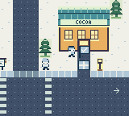
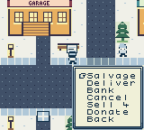

# Hollywild: Elf-Made Empire

An open-world holiday city adventure about overlooked properties, mischievous expeditions, and an elf-powered business empire.

**Status: native Game Boy Color prototype built and emulator-tested. Physical Chromatic testing is pending.**

Built for ModRetro Chromatic using GB Studio 4.3.2. The development computer runs the editor, compiler, and tests. The playable deliverable is a native `.gbc` cartridge.

## Playable foundation

- Five freely connected districts and an enterable garage.
- Original pixel art, characters, dialogue, and property listings.
- Salvage jobs, optional bonus salvage, deliveries, and cancellation.
- Workshop production and purchasable properties with visible ownership signs.
- Garage save/load and a restoration objective.

The inspiration is city freedom, earnest holiday comedy, property hunting, and strategy. The full campaign, driving, traffic, deeper crew assignments, and additional interiors remain planned. The current build uses simple sound effects and has no music soundtrack.

 

## Start here

- [Team builder assignments and handoffs](docs/TEAM_BUILD_PLAN.md)
- [Current build, test evidence, and limitations](docs/BUILD_STATUS.md)
- [Build or edit the native game](docs/DEVELOPMENT.md)
- [Production blueprint](BUILD_PLAN.md)
- [Open-world rules](docs/OPEN_WORLD.md)
- [Gameplay and economy design](docs/GAMEPLAY.md)
- [World and campaign design](docs/WORLD_AND_MISSIONS.md)
- [Engineering roadmap](docs/ENGINEERING.md)
- [Third-party notices](licenses/README.md)

## Controls and first steps

D-pad walks, A interacts and confirms, B closes menus, START opens the pocket book, and SELECT shows routes. Save at the garage checkpoint between jobs.

Start with 100 Coins. Leave the garage, accept Salvage at a job board, collect a marked depot crate, and Bank the haul. Repair the garage workshop, then finish a delivery to fund Cocoa Corner. Every district is open from the beginning, so this opening route is optional.

## AI and offline play

Codex assists development. Companions use authored behaviors and saved state. Live generative AI on the cartridge is neither verified nor required. The game does not use company data or live property feeds.

Published prototypes are development builds. Hardware playback, physical save persistence, and save compatibility between different builds remain unverified.
