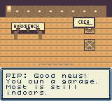
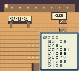
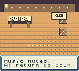

# Hollywild: simulated agent usability research

For the newer physical activities and entrance-discovery findings, see [the hands-on agent review](PLAYER_RESEARCH_ACTIONS.md).

Three blind, screen-and-button agent sessions examined newcomer onboarding, exploration, and readability/settings on the same frozen initial ROM (SHA-256 `3a9194dc9cddfa92e8cb8bd4e3037a2020e93eef74ca536fe20c8f2f8c753edd`). These are agent observations, not human playtests. Sessions were capped at 50 input batches or ten minutes. Screenshots and individual findings are under `test-results/player-research/`.

The strongest result is mixed: exploration worked, but the newcomer did not reach a useful first activity. The explorer independently reached Candy Row and Velvet Heights, met Moxie, and found an optional story. The settings tester found Music and selected Mute. No initial blind session completed a job or tested meaningful saved progress. A later experienced-agent retest completed salvage, restored the garage, and assigned Rivet.

## Findings and response

| Priority | Observed evidence | Response status |
|---|---|---|
| High | World signs and player sprites visibly cover pocket-book labels and borders. `newcomer/screen-026.png` | Fixed and verified on the final build: clear labels during menus and restored sprites after closing. |
| High | The newcomer understood the salvage/repair objective but tried the garage crate three ways without a response, then encountered the four-scrap repair requirement. No scrap, job, repair, or earnings were achieved within the session budget. | Targeted experienced-agent retest completed salvage and garage restoration using revised directions; see verification scope below. |
| Medium | The opening requires roughly ten to eleven A advances before movement, depending on counting the title. This consumed a substantial portion of the bounded interaction budget. | Final retest confirmed exactly five introduction pages. An interim retest caught seven pages caused by wrapping. This is an interaction-count observation, not a human pacing conclusion. |
| Medium | B closes the pocket-book menu but did not dismiss observed Guide, story, or route description pages. The tutorial's “B: close menus” leaves that distinction unclear. | Clearer B/cancel wording and complete controls verified in the final UI retest. |
| Medium | Optional stories require Start, two status pages, Side, Stories, a story selection, and description pages. The explorer found the delivery story and understood its next destination, but the path is deep. | Remains a navigation limitation. |
| Medium | Music was found through Guide and Mute selected. The menu returned to the world with no visible confirmation of the resulting setting. `readability/screen-034.png`, `readability/screen-035.png` | Final UI retest confirmed visible music-setting feedback. Final-hash native checks verified zero muted output and saved mute after reboot. No audio-quality conclusion follows. |
| Medium | The newcomer found no explicit save action or save instruction. Restart returned to the opening, but no meaningful progress had been completed. | Save visibility remains a limitation. This is not evidence of save failure. |

## Verification scope

The interim ROM SHA-256 was `9c4ee37332aa2eef7ce5145788d2aeb0538357750cf03a1c429c637619914241`. Its targeted first-activity retest used an experienced agent, not a fresh blind participant, and stopped after 57 input batches plus stop. Screens showed salvage banked at +10 scrap (`newcomer_retest/screen-037.png`), garage restoration (`newcomer_retest/screen-053.png`), and final counters of 60 coins and 6 scrap (`newcomer_retest/screen-057.png`). Rivet assignment was also reported. This closes the initial task blocker for the targeted route, but does not establish fresh-player discoverability or human completion time.

A separate targeted UI retest on that hash confirmed unobscured menu labels, music confirmation, and restored world sprites after closing. Native sound-routing checks reportedly passed all 35 commands on the same hash, including zero muted signal and persisted mute after reboot. These are implementation checks, separate from the blind research. The final ROM SHA-256 is `e69ccb06012236e201dafe92a82d964550069f46b815be177271b071cc97879b`. Its UI retest checked 18 observations: all 16 dialogue/menu states hid hardware sprites, and two world states restored them. Exactly five introduction pages and complete controls/directions were confirmed. The screen-only agent first-activity completion above was on the interim hash. A separate automated button replay of that opening loop passed on the final hash. Final-hash native audio checks passed 35 routing commands and 452 finale commands (`test-results/audio-report.json`). All seven original tracks produced nonzero, unclipped native APU samples; 2.987 seconds of muted output were digital zero, and saved mute persisted after reboot. A 94.685-second finale capture continued sounding beyond its approximately 77-second first loop. This is technical signal verification, not agent listening or a human judgment of the music.

Representative final-build screens:

| Introduction | Clear pocket-book menu | Music confirmation |
|---|---|---|
|  |  |  |

## What worked

- Exploration was available before the suggested opening activity. The explorer walked directly from Frostwick to Candy Row.
- Moxie's north-shortcut hint was actionable: the explorer followed it and reached Velvet Heights. `explorer/screen-030.png`, `explorer/screen-045.png`.
- The delivery story supplied a concrete next destination: “Begin at Frostwick Depot.” `explorer/screen-041.png`. The explorer had not located the Depot by session end.
- Roads, sidewalks, buildings, and NPC silhouettes were distinguishable. Text boxes used large dark letters on pale backgrounds. Repair rejection clearly explained insufficient scrap and said coins were not spent.
- The route reference provided a usable loop-and-shortcuts description. It was text guidance rather than a spatial map.

## Reading uncertainty and limits

Initial agent reports described some text as clipped, malformed, or missing words. Direct screenshot review contradicted those readings: the newcomer job instruction is complete in `newcomer/screen-007.png`, and the Music explanation is complete in `readability/screen-032.png`. The readability tester also rechecked controls after a longer wait and retracted clipping impressions. This image-reading uncertainty was caught by independent screenshot review and is an important method limit. No text-truncation defect is established by this research. Stylized lettering and apparent spacing remain subjective reading observations, not confirmed missing content.

These sessions do not establish human enjoyment, accessibility compliance, audio quality, real-time pacing, economy balance, long-term reward, all-district coverage, save reliability, or quest completion. Targeted retests and their ROM hashes are distinguished above. Remaining limits include save visibility, optional-story menu depth, fresh-player discoverability, and absent human or physical-hardware evaluation.
