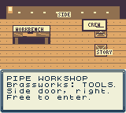
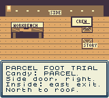

# Agent usability review: hands-on activities

This was one screen-only AI-agent session, not a human playtest. The participant used a fresh cartridge, ordinary buttons and screenshots. It did not read source, answers, debug symbols, navigation helpers or game variables. Its task was to locate and try the pipe workshop and, if time allowed, the rooftop parcel trial.

## Tested build and outcome

The session used ROM `05ed1448956c15f8ddfc03c5919fd897ebcb0fe1594ccad8b4aa1012a0fe6449`. It lasted 440.70 wall seconds and recorded 71 commands. That duration includes agent reasoning and tool calls; it is not a player's traversal time.

The participant reached Brassworks but did not locate Control or play either activity. This is evidence about discovery and navigation. It provides no evidence that the new activities are fun or confusing once reached.

## Observed findings

- SELECT's district route order helped the participant reach Brassworks through Candy Row.
- The visible TOOLS sign led to a purchase conversation. The participant did not recognize the separate free public entrance.
- START showed two status pages before its menu. Guide placed Play below Back; the participant chose Help and traversed several pages instead.
- Plain dialogue lacked a visible next-page cue. B did not dismiss introductory text, but did cancel the subsequent purchase menu.
- A nearby book-shaped contact opened neighborhood stories rather than leading toward Control.
- The participant inferred building collisions after moving along a road succeeded where movement beside the building had not.

## Response in the release

Guide now lists Help, Music, Play, Back. Play supplies exact entrance directions for both activities: the named building, its small right-side door, the interior east exit and the next north connection. Help explicitly distinguishes property-sale signs from free public doors. These changes target the observed failure to find the activities.

The final build's UI test captures every directions page. Button-driven route tests independently traverse the relevant public rooms and complete both activities. This does not constitute a second blind usability session. START's two status pages, limited door labeling and missing text-page advance cues remain limitations.

 

## Separate technical and visual checks

Another reviewer inspected the actual rendered garage, pipe and route screenshots. Labels and pipe connections were readable and aligned. The garage's repaired bench and light persisted on return; the small crawler detail was partly obscured and is a secondary detail. The route's open half-lanes appear wide enough, with actual movement established separately by cartridge replays.

Native tests cover all three route outcomes, improvement-only rewards, pipe solving and rotation, reset, and checkpoint save/restart. A separate source checker compares all 256 pipe configurations to an independent connectivity model. Neither those tests nor the agent session measure human enjoyment, campaign duration or physical Chromatic behavior.
